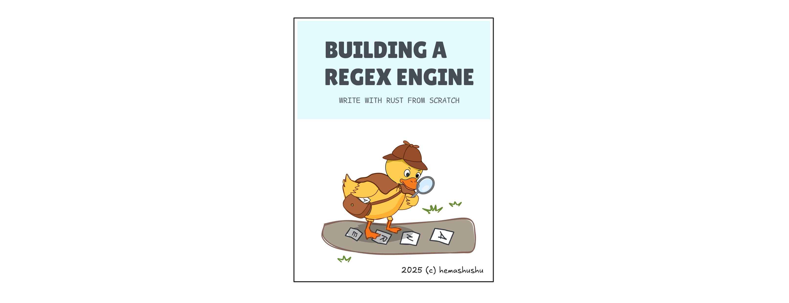

# Regex ANRE


[](https://crates.io/crates/regex-anre) [](https://docs.rs/regex-anre) [](https://github.com/hemashushu/regex-anre)

[Regex-anre](https://github.com/hemashushu/regex-anre) is a full-featured, zero-dependency regular expression engine that supports both traditional regular expressions and the ANRE language.

Regex-anre provides the core API of [Rust-regex](https://docs.rs/regex/) (the widely used `regex` crate), so common usage can switch over by changing only the crate name and import path.

<!-- @import "[TOC]" {cmd="toc" depthFrom=2 depthTo=4 orderedList=false} -->

<!-- code_chunk_output -->

- [1. Features](#1-features)
- [2. Quick Start](#2-quick-start)
  - [2.1 Find a specific pattern in a string](#21-find-a-specific-pattern-in-a-string)
  - [2.2 Match text and get each capturing group](#22-match-text-and-get-each-capturing-group)
  - [2.3 Validate a string](#23-validate-a-string)
- [3. Regular Expression Cheatsheet](#3-regular-expression-cheatsheet)
  - [3.1 Literals](#31-literals)
  - [3.2 Repetition](#32-repetition)
    - [3.2.1 Greedy quantifiers](#321-greedy-quantifiers)
    - [3.2.2 Lazy quantifiers](#322-lazy-quantifiers)
  - [3.3 Assertions](#33-assertions)
    - [3.3.1 Boundary assertions](#331-boundary-assertions)
    - [3.3.2 Lookaround assertions](#332-lookaround-assertions)
  - [3.4 Groups](#34-groups)
    - [3.4.1 Sequences](#341-sequences)
    - [3.4.2 Captures and backreferences](#342-captures-and-backreferences)
  - [3.5 Logical Operators](#35-logical-operators)
- [4. The ANRE Language](#4-the-anre-language)
  - [4.1 Literals](#41-literals)
    - [4.1.1 Characters](#411-characters)
    - [4.1.2 Strings](#412-strings)
    - [4.1.3 Character Sets](#413-character-sets)
  - [4.2 Functions](#42-functions)
    - [4.2.1 Nested Invocations](#421-nested-invocations)
    - [4.2.2 Method-like Invocation](#422-method-like-invocation)
    - [4.2.3 Chaining Invocations](#423-chaining-invocations)
  - [4.3 Repetition](#43-repetition)
  - [4.4 Boundary Assertions](#44-boundary-assertions)
  - [4.5 Lookaround Assertions](#45-lookaround-assertions)
  - [4.6 Logical Operators](#46-logical-operators)
  - [4.7 Groups](#47-groups)
  - [4.8 Capturing Groups and Backreferences](#48-capturing-groups-and-backreferences)
    - [4.8.1 Capturing Groups](#481-capturing-groups)
    - [4.8.2 Backreferences](#482-backreferences)
  - [4.9 Separator and Multiline](#49-separator-and-multiline)
  - [4.10 Macros](#410-macros)
  - [4.11 Comments](#411-comments)
- [5. Examples](#5-examples)
  - [5.1 Matching Decimal Numbers](#51-matching-decimal-numbers)
  - [5.2 Matching Hexadecimal Numbers](#52-matching-hexadecimal-numbers)
  - [5.3 Email Address Validation](#53-email-address-validation)
  - [5.4 IPv4 Address Validation](#54-ipv4-address-validation)
  - [5.5 Matching Simple HTML Tags](#55-matching-simple-html-tags)
- [6. Learn More](#6-learn-more)
- [7. Links](#7-links)
- [8. License](#8-license)

<!-- /code_chunk_output -->

## 1. Features

- **Lightweight**: Regex-anre is built from scratch without any dependencies, making it extremely lightweight — its compiled binary is roughly one-tenth the size of the Rust-regex library.

- **Full-featured**: Regex-anre supports all common regular expression features, plus backreferences and lookahead/lookbehind assertions, which Rust-regex does not support.

- **Maintainable**: Regex-anre has a clean, modular code structure that is easy to read and understand, and, most importantly, it is well documented.

- **Reasonable performance**: Regex-anre matches text about 3 to 5 times slower than Rust-regex, which is still reasonably fast. In return, it compiles patterns much faster than Rust-regex, making it well suited to patterns created at runtime.

- **A new language**: ANRE is a function-based language designed to be easy to read and write. Every ANRE expression can be translated one-to-one into a traditional regular expression and vice versa, which reduces the cognitive load of writing complex patterns.

- **Compatibility**: Regex-anre implements the core API of Rust-regex (`Regex::new`, `find`, `find_iter`, `captures`, `captures_iter`, `is_match`, etc.), so in most projects you only need to change the crate name and import path. Note that some methods, such as `replace` and `split`, are not provided.

## 2. Quick Start

Add the crate [regex-anre](https://crates.io/crates/regex-anre) to your project from the command line:

```bash
cargo add regex-anre
```

Or add it to your `Cargo.toml` manually:

```toml
[dependencies]
regex-anre = "2.1"
```

The following examples demonstrate three typical uses of regular expressions.

### 2.1 Find a specific pattern in a string

```rust
use regex_anre::Regex;

// Find hexadecimal color codes with a traditional regex
let re = Regex::new(r"#[\da-fA-F]{6}").unwrap();

// The same pattern in ANRE
let re = Regex::from_anre("('#', [char_digit, 'a'..'f', 'A'..'F'].repeat(6))").unwrap();

let text = "The color is #ffbb33 and the background is #bbdd99.";

// Find one match
if let Some(m) = re.find(text) {
    println!("Found match: {}", m.as_str());
} else {
    println!("No match found");
}

// Find all matches
for m in re.find_iter(text) {
    println!("Found match: {}", m.as_str());
}
```

### 2.2 Match text and get each capturing group

```rust
use regex_anre::Regex;

// Capture the RGB components of hexadecimal color codes with a traditional regex
let re =
    Regex::new(r"#(?<red>[\da-fA-F]{2})(?<green>[\da-fA-F]{2})(?<blue>[\da-fA-F]{2})").unwrap();

// The same pattern in ANRE
let re = Regex::from_anre(
    "
    /* ANRE supports comments, multi-line layout, and macros,
     * which make patterns easier to read and maintain.
     */

    (
        // A macro `hex` for a single hexadecimal digit
        define hex ([char_digit, 'a'..'f', 'A'..'F'])

        // A macro `two_hex` for two hexadecimal digits
        define two_hex (hex.repeat(2))

        // A hexadecimal color code starts with `#`
        '#'

        // Named capturing groups for the red, green, and blue components
        two_hex as red
        two_hex as green
        two_hex as blue
    )"
).unwrap();

let text = "The color is #ffbb33 and the background is #bbdd99.";

// Find the first match and print its capturing groups
if let Some(m) = re.captures(text) {
    println!("Found match: {}", m.get(0).unwrap().as_str());
    println!("Red: {}", m.name("red").unwrap().as_str());
    println!("Green: {}", m.name("green").unwrap().as_str());
    println!("Blue: {}", m.name("blue").unwrap().as_str());
} else {
    println!("No match found");
}

// Find all matches and print their capturing groups
for m in re.captures_iter(text) {
    println!("Found match: {}", m.get(0).unwrap().as_str());
    println!("Red: {}", m.name("red").unwrap().as_str());
    println!("Green: {}", m.name("green").unwrap().as_str());
    println!("Blue: {}", m.name("blue").unwrap().as_str());
}
```

### 2.3 Validate a string

```rust
use regex_anre::Regex;

// Validate a date string in the format `YYYY-MM-DD` with a traditional regex
let re = Regex::new(r"^\d{4}-\d{2}-\d{2}$").unwrap();

// The same pattern in ANRE
let re = Regex::from_anre(
    "
    /* Validate a date string in the format `YYYY-MM-DD`.
     * `is_start()` and `is_end()` assert the start and end of the string,
     * ensuring that the entire string matches the pattern.
     */

    (
        is_start()
        char_digit.repeat(4)
        '-'
        char_digit.repeat(2)
        '-'
        char_digit.repeat(2)
        is_end()
    )"
).unwrap();

println!("{}", re.is_match("2025-04-22")); // true
println!("{}", re.is_match("04-22")); // false
```

## 3. Regular Expression Cheatsheet

The following tables list common regular expression patterns and their ANRE equivalents.

### 3.1 Literals

| Regex Pattern | ANRE Expression           | Description                                            |
|---------------|---------------------------|--------------------------------------------------------|
| `a`           | `'a'`                     | Match a single character                               |
| `abc`         | `"abc"`                   | Match a series of characters in order                  |
| `[abc]`       | `['a', 'b', 'c']`         | Match any character in the set                         |
| `[a-z]`       | `['a'..'z']`              | Match any character in the range                       |
| `[a-zA-Z]`    | `['a'..'z', 'A'..'Z']`    | Match any character in the combined ranges             |
| `[^abc]`      | `!['a', 'b', 'c']`        | Match any character not in the set                     |
| `\d`          | `char_digit`              | Match any digit character (0-9)                        |
| `\D`          | `char_not_digit`          | Match any non-digit character                          |
| `\w`          | `char_word`               | Match any ASCII word character (`[A-Za-z0-9_]`)        |
| `\W`          | `char_not_word`           | Match any non-word character                           |
| `\s`          | `char_space`              | Match any whitespace character (space, `\t`, `\r`, `\n`) |
| `\S`          | `char_not_space`          | Match any non-whitespace character                     |
| `[a-f\d]`     | `['a'..'f', char_digit]`  | Match any character in the set (ranges and predefined classes can be combined) |
| `.`           | `char_any`                | Match any character except `\n` and `\r`               |

### 3.2 Repetition

#### 3.2.1 Greedy quantifiers

| Regex Pattern | ANRE Expression           | Description                                      |
|---------------|---------------------------|--------------------------------------------------|
| `a?`          | `'a'?`                    | Match zero or one occurrence of 'a'              |
| `a+`          | `'a'+`                    | Match one or more occurrences of 'a'             |
| `a*`          | `'a'*`                    | Match zero or more occurrences of 'a'            |
| `a{n}`        | `'a'{n}`                  | Match exactly n occurrences of 'a', n >= 0       |
| `a{n,}`       | `'a'{n..}`                | Match at least n occurrences of 'a', n >= 0      |
| `a{m,n}`      | `'a'{m..n}`               | Match between m and n occurrences of 'a' (inclusive), n >= m |

#### 3.2.2 Lazy quantifiers

Lazy quantifiers match as few characters as possible while still allowing the overall match to succeed. They are written by appending `?` to a greedy quantifier. For example, `a??` matches zero or one 'a', but prefers zero.

| Regex Pattern | ANRE Expression           | Description                                      |
|---------------|---------------------------|--------------------------------------------------|
| `a??`         | `'a'??`                   | Match zero or one occurrence of 'a'              |
| `a+?`         | `'a'+?`                   | Match one or more occurrences of 'a'             |
| `a*?`         | `'a'*?`                   | Match zero or more occurrences of 'a'            |
| `a{n}?`       | `'a'{n}?`                 | Identical to `'a'{n}`, n >= 0                    |
| `a{n,}?`      | `'a'{n..}?`               | Match at least n occurrences of 'a', n >= 0      |
| `a{m,n}?`     | `'a'{m..n}?`              | Match between m and n occurrences of 'a' (inclusive), n >= m |

Note that `a{n}?` behaves exactly like `a{n}`: a fixed count leaves no room for laziness.

### 3.3 Assertions

#### 3.3.1 Boundary assertions

| Regex Pattern  | ANRE Expression          | Description                         |
|----------------|--------------------------|-------------------------------------|
| `^`            | `is_start()`             | Match the start of the string       |
| `$`            | `is_end()`               | Match the end of the string         |
| `\b`           | `is_bound()`             | Match a word boundary               |
| `\B`           | `is_not_bound()`         | Match a non-word boundary           |

#### 3.3.2 Lookaround assertions

| Regex Pattern  | ANRE Expression          | Description                         |
|----------------|--------------------------|-------------------------------------|
| `a(?=...)`     | `'a'.is_before(...)`     | Positive lookahead                  |
| `a(?!...)`     | `'a'.is_not_before(...)` | Negative lookahead                  |
| `(?<=...)a`    | `'a'.is_after(...)`      | Positive lookbehind                 |
| `(?<!...)a`    | `'a'.is_not_after(...)`  | Negative lookbehind                 |

### 3.4 Groups

#### 3.4.1 Sequences

| Regex Pattern  | ANRE Expression          | Description                         |
|----------------|--------------------------|-------------------------------------|
| `abc\d+`       | `("abc", char_digit+)`   | Sequence of patterns or expressions |
| `(?:abc\d+)`   | `("abc", char_digit+)`   | Non-capturing group                 |

#### 3.4.2 Captures and backreferences

| Regex Pattern  | ANRE Expression          | Description                         |
|----------------|--------------------------|-------------------------------------|
| `(abc)`        | `#("abc")`               | Indexed capturing group             |
| `\1`           | `^1`                     | Indexed backreference               |
| `(?<name>abc)` | `"abc" as name`          | Named capturing group               |
| `\k<name>`     | `name`                   | Named backreference                 |

### 3.5 Logical Operators

| Regex Pattern  | ANRE Expression                   | Description                |
|----------------|-----------------------------------|----------------------------|
| `a\|b`         | `'a' \|\| 'b'`                    | Logical OR (alternation)   |
| `(?:a\|b)c`    | `('a' \|\| 'b', 'c')`             | Sequence with alternation  |
| `abc\d+\|foo`  | `("abc", char_digit+) \|\| "foo"` | Alternation with sequences |

## 4. The ANRE Language

ANRE is a function-based language designed to be easy to read and write. Every ANRE expression can be translated one-to-one into a traditional regular expression and vice versa.

The language is simple. It consists of literals, functions, groups, a logical `OR` operator, a few prefix operators, and identifiers:

- **Literals** are the basic building blocks: characters, strings, and character sets.
- **Functions** operate on expressions, for example to repeat them. Most take an expression (and sometimes numbers) and return a new expression; a few, such as the boundary assertions, take no arguments.
- **Groups** join several expressions into one. A group is required whenever there is more than one expression at the root level.
- **The logical operator** `||` combines expressions as alternatives.
- **Prefix operators**: `!` negates a character set, `#` creates an indexed capturing group, and `^` refers back to an indexed group.
- **Identifiers** name macros and capturing groups (`as name`). Once defined, they can be used like expressions.

Everything that matches text, from a single character to a whole group, is called an _expression_.

### 4.1 Literals

Literals are the most basic expressions in ANRE: characters, strings, and character sets.

#### 4.1.1 Characters

A character literal matches exactly one character. It is enclosed in single quotes and can be any single Unicode code point, including letters, digits, symbols, and emojis.

For example:

- `'a'`
- `'文'`
- `'😊'`

> A character literal must contain exactly one code point. Some emojis, such as `❤️` (U+2764 U+FE0F), consist of several code points; write them as string literals instead.

Character literals also support escape sequences for characters that are hard to type directly:

| Escape Sequence | Character         | Description                         |
|-----------------|-------------------|-------------------------------------|
| `\\`            | `\`               | Backslash                           |
| `\'`            | `'`               | Single quote                        |
| `\"`            | `"`               | Double quote                        |
| `\n`            | Newline           | Line feed                           |
| `\r`            | Carriage return   | Carriage return                     |
| `\t`            | Tab               | Horizontal tab                      |
| `\0`            | Null character    | Null character                      |
| `\u{X}`         | Unicode character | Unicode character with code point X |

Here `X` is a hexadecimal number (digits `0-9`, `a-f`, `A-F`) in the range `0` to `10FFFF`, excluding the surrogate range `D800` to `DFFF`.

#### 4.1.2 Strings

A string literal matches an exact sequence of characters. It is enclosed in double quotes and can contain any characters, including escape sequences.

For example:

- `"hello world"`
- `"你好，世界！"`
- `"I ❤️ Rust!"`
- `"\u{6587}\u{5b57}"`

#### 4.1.3 Character Sets

A character set matches any single character that belongs to it. It is written as a comma-separated list of characters and character ranges enclosed in square brackets. Ranges include both endpoints.

For example:

- `['a', 'b', 'c']`: matches any character that is 'a', 'b', or 'c'.
- `['a'..'z']`: matches any lowercase letter from 'a' to 'z'.
- `['0'..'9', 'a'..'z', '-']`: matches any digit, lowercase letter, or hyphen.

##### 4.1.3.1 Negated Character Sets

A negated character set matches any character that is not in the set. It is written by prefixing a character set with an exclamation mark `!`.

For example:

- `!['a', 'b', 'c']`: matches any character that is not 'a', 'b', or 'c'.
- `!['a'..'z']`: matches any character that is not a lowercase letter.
- `!['0'..'9', 'a'..'z', '-']`: matches any character that is not a digit, lowercase letter, or hyphen.

For the source string `"abc123-xyz"`, the character set `['a'..'z']` matches the characters 'a', 'b', 'c', 'x', 'y', and 'z', while the negated set `!['a'..'z']` matches '1', '2', '3', and '-'.

##### 4.1.3.2 Nested Character Sets

Character sets can be nested to build more complex sets, for example:

```anre
[
    ['a'..'z', 'A'..'Z']
    ['0'..'9']
    ['+', '-', '_']
]
```

> ANRE expressions can span multiple lines, which makes them easier to read and maintain.

This character set combines three character sets:

- one for letters (both lowercase and uppercase)
- one for digits
- one for punctuation characters

It is equivalent to `['a'..'z', 'A'..'Z', '0'..'9', '+', '-', '_']`, but easier to read and maintain.

Note that negated character sets cannot be nested; for example, `[!['0'..'9']]` is not a valid expression.

##### 4.1.3.3 Predefined Character Classes

ANRE also provides predefined character classes for common sets of characters. They are written as identifiers:

| Character Class  | Description                                             |
|------------------|---------------------------------------------------------|
| `char_digit`     | Matches any digit character (0-9)                       |
| `char_not_digit` | Matches any non-digit character                         |
| `char_word`      | Matches any ASCII word character (`[A-Za-z0-9_]`)       |
| `char_not_word`  | Matches any non-word character                          |
| `char_space`     | Matches any whitespace character (space, `\t`, `\r`, `\n`) |
| `char_not_space` | Matches any non-whitespace character                    |
| `char_any`       | Matches any character except `\n` and `\r`               |

Predefined character classes can also be used inside character sets, for example:

`[char_word, '+', '-', '_']`

However, the negated classes (`char_not_digit`, `char_not_word`, and `char_not_space`) cannot be used inside character sets; for example, `['a', char_not_digit]` is not a valid expression.

### 4.2 Functions

ANRE uses functions to express repetition, assertions, and captures.

For example:

`repeat('a', 3)`

This calls the function `repeat` with two arguments: the expression `'a'` and the number 3. It matches exactly three 'a's and is equivalent to the regex `a{3}`.

Most functions take an expression (plus optional extra arguments) and return a new expression:

`function_name(expression, args...) -> expression`

Some functions take no arguments. For example, `is_start()` asserts the start of the string and is equivalent to the regex `^`.

#### 4.2.1 Nested Invocations

Because functions take and return expressions, calls can be nested to build more complex expressions.

For example:

`optional(repeat('a', 3))`

Here the result of `repeat('a', 3)` is passed to `optional`. The expression matches either nothing or exactly three 'a's, and is equivalent to the regex `(?:a{3})?`.

#### 4.2.2 Method-like Invocation

ANRE also supports method-like syntax, in which the first argument is written before the function name. For example, `repeat('a', 3)` can be written as `'a'.repeat(3)`.

Syntax:

`expression.function_name(args...) -> expression`

#### 4.2.3 Chaining Invocations

Method-like calls can be chained, just as function calls can be nested. For example, the following expressions are equivalent:

- `optional(repeat('a', 3))`
- `'a'.repeat(3).optional()`

Method-like syntax is more concise and readable, so it is recommended wherever possible.

### 4.3 Repetition

Repetition matches a pattern multiple times. As mentioned above, ANRE provides repetition functions such as `repeat`, `repeat_from`, and `repeat_range`. Because they are used so often, ANRE also provides shorthand notation for them: `?`, `+`, `*`, `{n}`, `{n..}`, and `{m..n}`.

The following table lists the repetition functions and their notation:

| Function                  | Method                   | Notation    | Description                                         |
|---------------------------|--------------------------|-------------|-----------------------------------------------------|
| `optional(exp)`           | `exp.optional()`         | `exp?`      | Match zero or one occurrence of the expression      |
| `one_or_more(exp)`        | `exp.one_or_more()`      | `exp+`      | Match one or more occurrences of the expression     |
| `zero_or_more(exp)`       | `exp.zero_or_more()`     | `exp*`      | Match zero or more occurrences of the expression    |
| `repeat(exp, n)`          | `exp.repeat(n)`          | `exp{n}`    | Match exactly n occurrences of the expression       |
| `repeat_from(exp, n)`     | `exp.repeat_from(n)`     | `exp{n..}`  | Match at least n occurrences of the expression      |
| `repeat_range(exp, m, n)` | `exp.repeat_range(m, n)` | `exp{m..n}` | Match between m and n occurrences of the expression |

For example, for the source string `"aa-aaa-aaaa"`:

- `'a'.repeat(2)` matches "aa" at indices 0, 3, 7, and 9.
- `'a'.repeat_from(3)` matches "aaa" at index 3 and "aaaa" at index 7.
- `'a'.repeat_range(1, 3)` matches "aa" at index 0, "aaa" at index 3, "aaa" at index 7, and "a" at index 10.

> `m` and `n` must be non-negative integers, and `n` must be greater than or equal to `m`; otherwise the expression is invalid. Unlike Rust's `..` operator, the range `{m..n}` includes `n`.

Since every repetition function takes an expression as its first argument and returns a new expression, repetitions can be chained with method-like syntax.

For example, `"abc".repeat(2).optional()` is equivalent to `optional(repeat("abc", 2))`.

Repetition is greedy by default: it matches as many characters as possible while still allowing the overall match to succeed. For example, for the source string `"aaaa"`, the expression `'a'.repeat_from(1)` matches "aaaa" at index 0.

Each repetition function also has a lazy version, such as `lazy_optional` and `lazy_repeat_range`. Lazy versions take the same arguments as their greedy counterparts, but match as few characters as possible.

| Function                       | Method                        | Notation     | Description                                         |
|--------------------------------|-------------------------------|--------------|-----------------------------------------------------|
| `lazy_optional(exp)`           | `exp.lazy_optional()`         | `exp??`      | Match zero or one occurrence of the expression      |
| `lazy_one_or_more(exp)`        | `exp.lazy_one_or_more()`      | `exp+?`      | Match one or more occurrences of the expression     |
| `lazy_zero_or_more(exp)`       | `exp.lazy_zero_or_more()`     | `exp*?`      | Match zero or more occurrences of the expression    |
| `lazy_repeat(exp, n)`          | `exp.lazy_repeat(n)`          | `exp{n}?`    | Match exactly n occurrences of the expression       |
| `lazy_repeat_from(exp, n)`     | `exp.lazy_repeat_from(n)`     | `exp{n..}?`  | Match at least n occurrences of the expression      |
| `lazy_repeat_range(exp, m, n)` | `exp.lazy_repeat_range(m, n)` | `exp{m..n}?` | Match between m and n occurrences of the expression |

For example, for the source string `"aaaa"`, the expression `'a'.lazy_repeat_from(1)` matches "a" at indices 0, 1, 2, and 3.

Note that laziness has no effect on a fixed count, so `lazy_repeat(exp, n)` is equivalent to `repeat(exp, n)`, i.e., `exp{n}`.

### 4.4 Boundary Assertions

ANRE has four boundary assertions, written as functions with no arguments: `is_start()`, `is_end()`, `is_bound()`, and `is_not_bound()`. They are equivalent to the regex assertions `^`, `$`, `\b`, and `\B` respectively.

| Assertion        | Description                         |
|------------------|-------------------------------------|
| `is_start()`     | Match the start of the string       |
| `is_end()`       | Match the end of the string         |
| `is_bound()`     | Match a word boundary               |
| `is_not_bound()` | Match a non-word boundary           |

> Because boundary assertions take no arguments, they can only be written with function syntax, not method syntax.

A word boundary is a position between a word character and a non-word character; the start and end of the string count as non-word characters. For example, consider the string `"ab  cd"` (with two spaces):

| Position | Left Character | Right Character | Is Word Boundary? |
|----------|----------------|-----------------|-------------------|
| 0        | None           | 'a'             | Yes               |
| 1        | 'a'            | 'b'             | No                |
| 2        | 'b'            | ' '             | Yes               |
| 3        | ' '            | ' '             | No                |
| 4        | ' '            | 'c'             | Yes               |
| 5        | 'c'            | 'd'             | No                |
| 6        | 'd'            | None            | Yes               |

Here, "position" is the same as the character index: the character to the right of position `i` is the character at index `i`, and the character to the left is the one at index `i - 1`.

In short, `is_bound()` succeeds only when exactly one of the previous and current characters is a word character (`\w`).

**What is an assertion?**

An assertion checks whether a condition holds at the current position in the source string. If it holds, matching continues; if not, the current match attempt fails, and the engine backtracks or retries from the next position.

During matching, the engine keeps a cursor in the source string. Matching operations (such as literals and repetitions) check the characters at the cursor and, on success, move the cursor forward. For example, for the source string `"abc 123"`, the expression `char_word+` matches "abc" at index 0 and moves the cursor to position 3.

> Some documents say "consume characters" instead of "move the cursor". "Move the cursor" is more accurate, because the characters remain in the source string and can be matched again after backtracking.

Assertions, on the other hand, only check a condition; they never move the cursor. For example, for the source string `"abc 123"`, the expression `(char_word+, is_bound())` first matches "abc" and moves the cursor to position 3. It then checks the characters on both sides: 'c' is a word character and ' ' is not, so there is a word boundary and the assertion succeeds. Throughout the assertion, the cursor stays at position 3.

### 4.5 Lookaround Assertions

Lookaround assertions match an expression and then check whether another pattern appears immediately after (lookahead) or before (lookbehind) it, without including that pattern in the match. ANRE provides four lookaround functions, each taking two expressions:

| Function                          | Method                           | Regex          | Description         |
|-----------------------------------|----------------------------------|----------------|---------------------|
| `is_before(exp, next_exp)`        | `exp.is_before(next_exp)`        | `exp(?=next)`  | Positive lookahead  |
| `is_not_before(exp, next_exp)`    | `exp.is_not_before(next_exp)`    | `exp(?!next)`  | Negative lookahead  |
| `is_after(exp, previous_exp)`     | `exp.is_after(previous_exp)`     | `(?<=prev)exp` | Positive lookbehind |
| `is_not_after(exp, previous_exp)` | `exp.is_not_after(previous_exp)` | `(?<!prev)exp` | Negative lookbehind |

Examples:

- `char_word+.is_before("ing")`: matches word characters followed by "ing", e.g., "play" in "playing" and "sing" in "singing".
- `char_word+.is_not_before("ed")`: matches word characters not immediately followed by "ed". Note that it still matches the whole word "played", because nothing follows the final 'd'.
- `char_word+.is_after("pre")`: matches word characters preceded by "pre", e.g., "heat" in "preheat" and "fix" in "prefix".
- `char_word+.is_not_after("post")`: matches word characters not immediately preceded by "post". Similarly, it still matches the whole word "postfix", because nothing precedes the first 'p'.

> Lookbehind assertions (`is_after` and `is_not_after`) only support fixed-length patterns. For example, `char_word+.is_after("pre")` is valid because "pre" has a fixed length, but `char_word+.is_after(char_word+)` is invalid because `char_word+` can match a variable number of characters.

The first expression is matched normally and moves the cursor, while the asserted pattern does not. For example, for the source string `"playing"`, the expression `char_word+.is_before("ing")` first matches "play" at index 0 and moves the cursor to position 4. It then checks that the following characters are "ing". They are, so the assertion succeeds, and the cursor stays at position 4.

### 4.6 Logical Operators

ANRE has only one binary operator: logical `OR`, also known as alternation, written as `||`.

Syntax:

`expression1 || expression2 -> expression`

For example, the expression `"cat" || "dog"` matches either "cat" or "dog".

### 4.7 Groups

Groups combine multiple expressions into a single expression. A group is enclosed in parentheses `()`, and the expressions inside it are separated by commas `,` or whitespace.

Syntax:

`(expression1, expression2, ...) -> expression`

For example, `("abc", char_digit+)` matches the string "abc" followed by one or more digits.

ANRE allows only one expression at the root level, so multiple expressions must be wrapped in a group. For example, the following is invalid:

`is_start(), char_digit+, is_end()`

Wrapping the expressions in a group makes it valid:

`(is_start(), char_digit+, is_end())`

> ANRE groups only join expressions together; they are equivalent to non-capturing groups in traditional regular expressions. Traditional regular expressions need no operator to join a sequence, so `("abc", char_digit+)` can simply be written as `abc\d+`.

Groups are also used to override operator precedence. For example, suppose you want to match either a decimal number with the suffix "UL" or a binary number with the prefix "0b". The following expression does not work as expected:

`(char_digit+, "UL" || "0b", ['0', '1']+)`

This is because `||` binds more tightly than the `,` separator, so the expression is parsed as:

`(char_digit+, ("UL" || "0b"), ['0', '1']+)`

The correct way is to group each alternative:

`((char_digit+, "UL") || ("0b", ['0', '1']+))`

> In traditional regular expressions, `|` has lower precedence than concatenation, so the same pattern can be written without parentheses as `\d+UL|0b[01]+`.

### 4.8 Capturing Groups and Backreferences

Sometimes you need not only to match a pattern but also to extract specific parts of the matched text. This is what capturing groups are for.

#### 4.8.1 Capturing Groups

In ANRE, prefixing an expression with `#` captures the text it matches.

Syntax:

`#expression`

For example, `(#['a'..'z']+, #char_digit+)` matches lowercase letters followed by digits, and captures the letters and the digits separately. For the source string `"foo abc123 bar"`, it matches "abc123" and captures "abc" and "123" in groups 1 and 2 (index 0 is reserved for the entire match).

> `char_word` is not used for the first part here, because it also matches digits: `(#char_word+, #char_digit+)` would capture "abc12" and "3".

> The `#` operator has lower precedence than notation and method calls, so `#'a'?` is parsed as `#('a'?)`, and `#char_word.repeat(3)` as `#(char_word.repeat(3))`.

In addition to indexed capturing groups, ANRE supports named capturing groups, created by appending `as NAME` to an expression.

Syntax:

`expression as NAME`

Here `NAME` is an identifier that names the capturing group.

Named capturing groups can be accessed by name as well as by index. For example, `(['a'..'z']+ as word, char_digit+ as number)` captures the letters and the digits in groups named "word" and "number", with indices 1 and 2 respectively.

> A named capturing group is also an indexed one, so there is no need to prefix the expression with `#`.

ANRE also provides functions for creating capturing groups:

| Function          | Method           | Description             |
|-------------------|------------------|-------------------------|
| `index(exp)`      | `exp.index()`    | Indexed capturing group |
| `name(exp, NAME)` | `exp.name(NAME)` | Named capturing group   |

#### 4.8.2 Backreferences

Backreferences match the same text that a previous capturing group matched. An indexed backreference is written as `^` followed by the group index; a named backreference is simply the group name.

Syntax:

- By index: `^index`
- By name: `name`

For example, `(#char_word+, '-', ^1)` and `(char_word+ as word, '-', word)` both match a word, a hyphen, and the same word again, such as "foo-foo" but not "foo-bar".

### 4.9 Separator and Multiline

In ANRE, commas `,` and whitespace (including newlines) both separate the expressions in a group and the arguments of a function call. For example, the following expressions are equivalent:

- `("abc", char_digit+)`
- `("abc" char_digit+)`
- the multi-line form below:

```anre
(
    "abc"
    char_digit+
)
```

Commas and whitespace have the same meaning, so use whichever you prefer. Long or complex expressions are easier to read and maintain when spread across multiple lines.

### 4.10 Macros

Macros let you define reusable expressions. A macro is defined with the `define` keyword, followed by the macro name and an expression enclosed in parentheses.

Syntax:

`define macro_name (expression)`

Example:

```anre
define hex_digit (['0'..'9', 'a'..'f', 'A'..'F'])
define component (hex_digit.repeat(2))
(
    is_start()
    '#'
    component as red
    component as green
    component as blue
    is_end()
)
```

This example defines a macro `hex_digit` for a hexadecimal digit and a macro `component` for one color component (two hexadecimal digits). It then uses them to match a color code in the format `#RRGGBB`, where `RR`, `GG`, and `BB` are the red, green, and blue components.

> Macros are expanded by textual substitution before parsing. A definition can appear anywhere in the source, even inside a group, and applies to the whole expression.

### 4.11 Comments

ANRE supports block comments `/* ... */` and line comments `// ...`. Comments can appear anywhere and are ignored by the engine. For example:

```anre
(
    /* This is a block comment */
    "abc" // This is a line comment
    char_digit+
)
```

Block comments can be nested:

```anre
(
    /*
        This is a block comment
        /* This is a nested block comment */
    */
    "abc"
    char_digit+
)
```

Nested block comments are handy for temporarily commenting out part of an expression that already contains comments.

## 5. Examples

This section shows how to write ANRE expressions for some common tasks.

### 5.1 Matching Decimal Numbers

```anre
/**
 * Decimal number
 *
 * Examples:
 *
 * - "0"
 * - "123"
 */

char_digit.one_or_more()
```

### 5.2 Matching Hexadecimal Numbers

```anre
/**
 * Hexadecimal number
 *
 * Examples:
 *
 * - "0x0"
 * - "0x123"
 * - "0xabc"
 * - "0xDEADBEEF"
 */

(
    // The prefix "0x"
    "0x"

    // Hexadecimal digits
    ['0'..'9', 'a'..'f', 'A'..'F'].one_or_more()
)
```

### 5.3 Email Address Validation

```anre
/**
 * Email address validation
 *
 * Examples:
 *
 * - "abc@example.domain"
 * - "john-smith.new+mailbox-department@example.com"
 *
 * Ref:
 * https://en.wikipedia.org/wiki/Email_address
 */

(
    // Start of the string
    is_start()

    // Local part
    [char_word, '.', '-'].one_or_more()

    // Optional sub-address, e.g. "+mailbox"
    ('+', [char_word, '-'].one_or_more()).optional()

    // Separator
    '@'

    // Domain name labels, each followed by a dot
    (
        ['a'..'z', 'A'..'Z', '0'..'9', '-'].one_or_more()
        '.'
    ).one_or_more()

    // Top-level domain
    ['a'..'z', 'A'..'Z'].repeat_from(2)

    // End of the string
    is_end()
)
```

### 5.4 IPv4 Address Validation

```anre
/**
 * IPv4 address validation
 */

// Each part is a number from 0 to 255 without leading zeros
define num_25x ("25", ['0'..'5'])
define num_2xx ('2', ['0'..'4'], char_digit)
define num_1xx ('1', char_digit, char_digit)
define num_xx (['1'..'9'], char_digit)
define num_x (char_digit)
define part (num_25x || num_2xx || num_1xx || num_xx || num_x)

(is_start(), (part, '.').repeat(3), part, is_end())
```

### 5.5 Matching Simple HTML Tags

```anre
/**
 * Simple HTML tag
 */

(
    '<'                                         // opening tag
    char_word+ as tag_name                      // tag name
    (                                           // attributes
        char_space
        char_word+                              // key
        ('=', '"', char_word+, '"').optional()  // value
    )*
    '>'
    char_any*?                                  // text content
    "</", tag_name, '>'                         // closing tag
)
```

## 6. Learn More

To learn more about the ANRE language, how regular expression engines work, or how to build a full-featured one yourself, read my short book [Building a Regex Engine - Implementing a Comprehensive Regular Expression Engine with Rust](docs/building-a-regex-engine.md).



The book explains how regular expression engines work and walks you step by step through building one from scratch in Rust, covering every feature of this crate and more.

## 7. Links

- [Regex ANRE source code repository](https://github.com/hemashushu/anre)

## 8. License

This project is licensed under the Mozilla Public License 2.0 (MPL-2.0) with additional terms. See [LICENSE](./LICENSE) and [LICENSE.additional](./LICENSE.additional).
